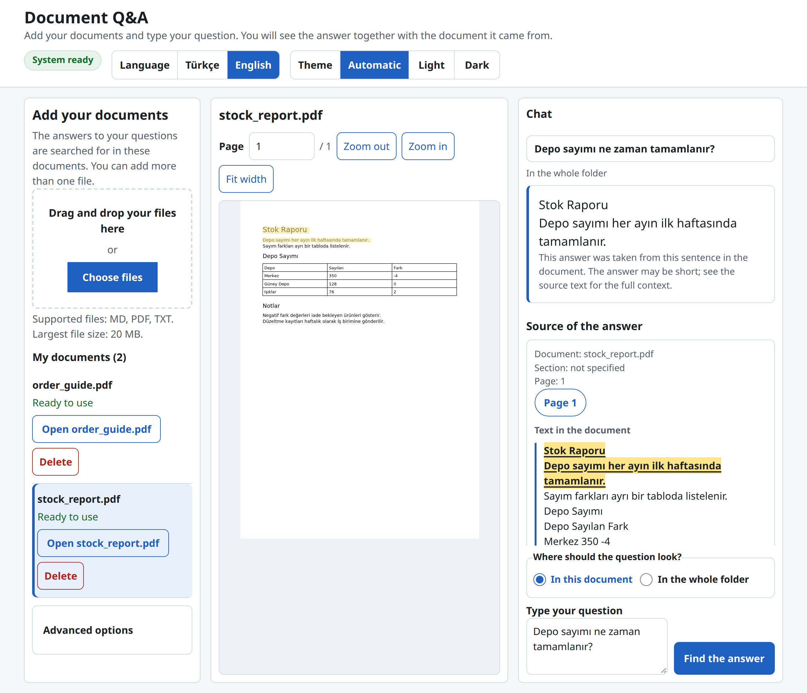
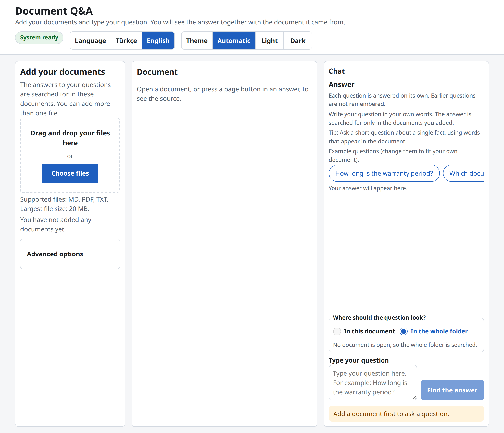
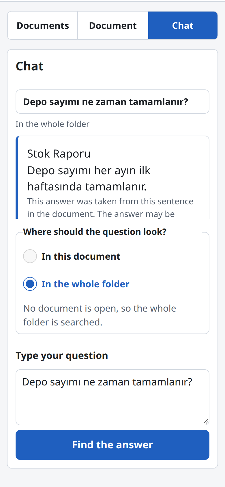
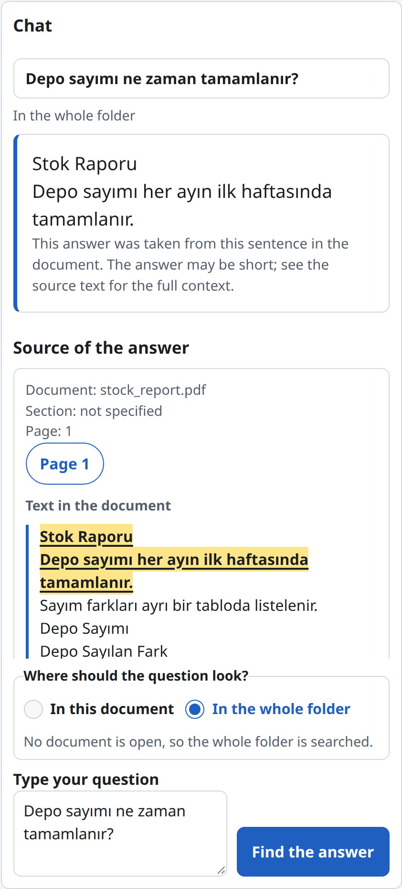

# consultqa

[](LICENSE)
[](https://github.com/ozlemhakdagli/consultqa/actions/workflows/ci.yml)


Does hybrid retrieval (BGE-M3 dense search and Turkish BM25 fused by reciprocal rank) find the passage that answers a question about Turkish documents better than the published dense-first concatenation, and can every answer be shown with its source?

consultqa answers questions about your documents and shows the passage each answer comes from. You upload PDF, TXT or Markdown files, ask a question in Turkish or English, and get the answer with its source text. Everything runs locally in Docker; documents never leave your machine, unless you configure an external LLM endpoint. On the public synthetic test split (**400 questions**, 480 passages in the sample), L2 reaches **MRR@10 0.551** against **0.284** for our re-run of the published method (L0), a paired difference of +0.268 [+0.227, +0.308]. The reranker, neighbouring passages and the evidence graph did not improve on L2, and the LLM answer mode is not measured. The data is synthetic ([Limitations](#limitations)).

<p align="center">
  
</p>
<p align="center"><sub>Screenshots use the sample documents in <code>data/sample/pdf/</code> and the stub backend (no models loaded). Regenerate them with <code>python scripts/capture_screenshots.py</code>.</sub></p>

## What is in the repository

| Folder | What |
| :--- | :--- |
| `src/consultqa/` | The service: `api/`, `ingest/`, `store/`, `retrieve/`, `graph/` (evidence graph), `generate/` (readers) and `eval/`. See the Backend section below. |
| `frontend/` | The web page: plain ES modules with no build step, served from `CONSULTQA_FRONTEND_DIR` (`/app/frontend` in the image). The bundled pdf.js is in `frontend/vendor/pdfjs/`; its licence is in `LICENSE` there and in [NOTICE](NOTICE). |
| `reference/paper_method/` | The published method (rung L0). |
| `data/sample/` | The public synthetic corpus and questions. The sample PDFs in `data/sample/pdf/` are generated by `scripts/make_sample_pdfs.py` and are not tracked. |
| `experiments/` | The protocol and the result tables, with their run headers. |
| `scripts/` | Model fetch, sample PDFs, graph tuning and the README screenshots. |
| `tests/` | Unit tests; browser tests are in `tests/e2e/`. |
| `assets/images/` | README screenshots, made from sample documents only. |
| `Dockerfile`, `compose.yml`, `Makefile` | The image, the stack of app and Qdrant, and shortcuts. |

The service runs with Docker Compose. Development uses one conda environment (`environment.yml`, named `hybrid-qa`).

## Running

### With Docker

You need Docker with Compose, about 12 GB of free disk space, the four pinned models and the Docling models. The first start takes several minutes: the image installs CPU PyTorch, and the service loads the models before `/api/ready` answers 200.

The models are the revisions pinned in `src/consultqa/config.py` (`MODEL_PINS`), and the Docling revisions are pinned in `scripts/fetch_models.py`. If they are already in your Hugging Face cache (`~/.cache/huggingface/hub`), copy them into the `models` volume rather than downloading them again:

```bash
# 1. Build the image
docker compose build app

# 2. Copy the pinned snapshot of each of the four cached models into the models volume (skip if you use step 2b)
#    cp -L copies the files the snapshot links to; onnx/, imgs/ and the jpg and webp files are skipped.
MODELS="models--BAAI--bge-m3/5617a9f61b028005a4858fdac845db406aefb181 models--BAAI--bge-reranker-v2-m3/953dc6f6f85a1b2dbfca4c34a2796e7dde08d41e models--deepset--xlm-roberta-large-squad2/dafe59921a75cdffc06ed3ad6e45c581b22b85cc models--sentence-transformers--multi-qa-mpnet-base-dot-v1/17997f24dca0df1a4fed68894fb0e1e133e60482"
docker compose --profile setup run --rm --no-deps -e MODELS="$MODELS" -v "$HOME/.cache/huggingface/hub:/src:ro" \
  --entrypoint sh fetch-models -c 'for m in $MODELS; do repo=${m%/*}; rev=${m##*/}; src=/src/$repo/snapshots/$rev; dst=/models/hub/$repo/snapshots/$rev; mkdir -p "$dst"; for f in $(ls -A "$src"); do case $f in onnx|imgs|*.jpg|*.webp) continue;; esac; cp -rL "$src/$f" "$dst/"; done; done'

# 2b. Without a cache, download the same revisions into the volume (about 7.3 GB)
#     docker compose --profile setup run --rm fetch-models

# 3. Start the app and Qdrant; --wait returns when the app is healthy
CONSULTQA_BACKEND=real docker compose up -d --wait app
```

Step 2 does not copy the Docling models. The cache keeps them in another folder layout, and the app reads them from `/models/docling` in the volume (`CONSULTQA_DOCLING_ARTIFACTS`), together with the RapidOCR models. Run `docker compose --profile setup run --rm fetch-models` after step 2 as well. It checks the four copied models and downloads the Docling models (about 0.5 GB). Without them, PDF uploads fail with `parse_failed`.

The paper baseline's embedder may be a symlink in the Hugging Face cache, which `cp -L` follows; if the copy reports a missing file for it, fetch the models with `fetch-models` (step 2b) instead.

Then open **http://127.0.0.1:8000/**. To check the service without downloading models, run `make smoke`. It starts the app with the stub backend and checks `/api/ready`; it replaces a running real-backend app container, so start the real backend again with step 3 afterwards.

### Development

```bash
conda env create -f environment.yml    # environment "hybrid-qa": Python 3.11 and the package with all extras
conda activate hybrid-qa
make test                              # unit tests; no model weights needed
make lint                              # ruff check and ruff format --check
CONSULTQA_BACKEND=stub python -m uvicorn consultqa.api.app:create_app --factory --port 8000   # the service without models
```

Checks, browser tests and the full reproduction are described under [Reproduce](#reproduce).

## Using the page

The page is in Turkish and English. It opens in Turkish when the browser language is Turkish and in English otherwise; the switch in the top bar (Türkçe / English) changes it, and the choice is saved in the browser. A theme switch (Automatic (Otomatik), Light (Açık), Dark (Koyu)) is saved in the browser too.

The page has three panes side by side:

- **Documents** (Belgeler): your documents and the add button.
- **Document** (Belge): the open document. A PDF is shown page by page with zoom and a page box; a text or Markdown file is shown as plain text.
- **Chat** (Sohbet): your questions and the answers, one after another, with the scope switch and the question box below them.

<p align="center">
  
</p>

Below 1000 px of width the panes become tabs above the content, and one pane shows at a time; the tab row chooses it. From 1000 px the three panes are shown together and the tabs are hidden.

<p align="center">
  
</p>

The steps are:

1. **Add your documents** (Belgelerinizi ekleyin). Drop PDF, TXT or Markdown files on the area or choose them. Each file shows its status: uploading, preparing, ready, or an error. Files are read, split into passages and indexed in the background. A ready document has an **Open** button (`Open {name}` / `{name} belgesini aç`) that shows it in the Document pane, and a **Delete** button (`Sil`) that removes the document and its original. Deleting the open document closes the Document pane.
2. **Type your question** (Sorunuzu yazın). Type the question in the chat pane and press "Find the answer" (Cevabı bul). The question and its answer stay on the page, one after another, so you can compare them. Each question is answered on its own. Earlier questions are not remembered. The answer appears with the document and section it came from, and the whole source passage is shown. The sentence that holds the answer is marked.
3. **Read the source.** Each source of a PDF has a page button, "Page n" (Sayfa n). It opens that page in the Document pane and marks the answer sentence on it, as in the viewer shown at the top of this page. The pages related to the question are listed under "Related pages" (İlgili sayfalar); their buttons open the page without a mark. If the sentence cannot be found on the page, the page still opens and the viewer says so.

<p align="center">
  
</p>

**Scope.** "Where should the question look?" (Soru nerede aransın?) has two choices. "In this document" (Bu belgede) searches only the open document; "In the whole folder" (Tüm klasörde) searches every document of the folder. Opening a document selects "In this document". The choice is read when a question is asked, and each answer shows the scope it was asked with. Without an open document only the whole folder can be searched.

**Select and ask.** Select text in the Document pane. A button under the selection, "Use this text as a question" (Bu metni soru olarak yaz), copies it into the question box without sending it. Change the text if you like, then press "Find the answer" (Cevabı bul).

**Default library:** the page uses one library, shown as "My documents" ("Belgelerim" in Turkish). It is created on your first visit and stored under the fixed name `Belgelerim` in both languages, so switching the language never creates a second library. Other libraries and the answer methods other than the recommended one are under "Advanced options" ("Gelişmiş seçenekler"), closed by default.

<details>
<summary><b>Where the originals are kept, and documents added before the viewer</b></summary>

**Where the originals are kept.** The service keeps the uploaded original of each document in the state folder, so the Document pane can show it later. With Docker that folder is the `state` volume (`/app/state/files`); otherwise it is `files` inside `CONSULTQA_STATE_DIR`. Deleting a document also deletes its original. Documents uploaded before the viewer existed have no original and no page numbers. They still answer questions, and the Document pane shows their text, page by page where pages are known, with a note that the document was added before the viewer existed. To get the original and the page numbers, add the file again: an upload replaces a document that has no original when it has the same content, or the same file name even if the content differs; every such old document in the folder is replaced. A document that has an original is never replaced, and the same content is not added twice in one folder. A PDF that the viewer cannot load is shown as text in the same way.

</details>

The answer is taken from one passage of your document, so it can be short. The answer card says so. Its source text is always shown.

## Languages

- **The page** is in Turkish and English. The switch in the top bar overrides the browser language and is remembered in the browser. The page never sends its language to the API.
- **Documents and answers** keep their own language. The reader takes a span of your document, so an English document gives English answers and a Turkish one gives Turkish answers. The page translates only the words around an answer (its notes and the labels of the source), never the answer or the source text.
- **Keyword search.** Turkish casefolding maps `I` to `ı`, which would stop "Invoices" and "invoice" from meeting in English text. For a document with no Turkish letter (`ç ğ ı ö ş ü İ`) the service lowercases with the default rule instead, and a question is matched under both rules when the library holds such a document. Documents with a Turkish letter are folded exactly as before. The evaluation code does not use this option, and a test checks that the sample corpus and the dev questions give the same tokens and rankings.
- **LLM prompt.** The instructions to the LLM are in English and ask for an answer in the language of the question. No LLM run has been measured, so no number depends on the prompt.

## Application architecture and development

The backend is described in the collapsible part below and the frontend in the next one; each lists the modules, settings and commands it relies on.

<details>
<summary><b>Backend (FastAPI service and ingestion jobs)</b> — <i>Click to expand</i></summary>

### Overview

The service is a FastAPI application built by the factory `consultqa.api.app:create_app`. It loads the models in a background thread while the server runs, and `/api/ready` answers 200 only once they are loaded. Uploads are ingested by background jobs, whose state is reported at `/api/jobs/<job_id>`. The SQLite database and the original files live in the folder set by `CONSULTQA_STATE_DIR`, and the dense vectors live in Qdrant. The image runs one Uvicorn worker.

### How a question is answered

- **L2, the API default:** dense BGE-M3 search and Turkish BM25 search, fused by reciprocal rank.
- **L3, a preset:** L2 plus the cross-encoder reranker `reranker-v2-m3`.
- **L4, a preset:** L3 plus the heading path and one neighbouring passage on each side.
- **L5, a preset:** L4 plus evidence-graph expansion, an LLM-free graph over chunks, sections and terms.
- **Reader:** the extractive reader (XLM-RoBERTa Large), or an OpenAI-compatible LLM reader for the `+llm` presets (`L4+llm`, `L5+llm`), which needs the LLM variables in the configuration table.
- **Paper method:** the `paper` preset (the published method) is offered only when `CONSULTQA_ENABLE_PAPER_BASELINE=1`.

The API default is `L2`; `L3` to `L5` are presets, selected with the `preset` field of a question.

### Running and testing

```bash
make test        # unit tests; no model weights needed
make lint        # ruff check and ruff format --check
make privacy     # checks the tracked files against the publication rules
make reproduce   # verifies the protocol hashes, then re-runs the dev and test ladders
```

`make smoke` starts the app with the stub backend and checks `/api/ready`. It replaces a running real-backend app container, so start the real backend again afterwards.

### API endpoints

All routes are under `/api` (the router prefix in `consultqa.api.routes`).

| Method and path | Description |
| :--- | :--- |
| `GET /api/health` | Reports that the process is alive. |
| `GET /api/ready` | Answers 200 once the models have loaded; 503 `not_ready` before. |
| `GET /api/presets` | Lists the preset names, with `paper` when the published method is enabled. |
| `GET /api/capabilities` | Reports readiness, upload limits, the default preset and which methods can be used. |
| `POST /api/collections` | Creates a collection (library) and returns its id (201). |
| `GET /api/collections` | Lists the collections. |
| `DELETE /api/collections/{cid}` | Deletes a collection with its documents, chunks, graph, jobs and vectors (204). |
| `POST /api/collections/{cid}/documents` | Accepts an upload and starts its ingestion job (202). |
| `GET /api/jobs/{job_id}` | Reports the state of an ingestion job. |
| `GET /api/collections/{cid}/documents` | Lists the documents of a collection. |
| `GET /api/collections/{cid}/documents/{doc_id}/file` | Returns the stored original of a document, inline. |
| `GET /api/collections/{cid}/documents/{doc_id}/text` | Returns the passages of a document grouped by page, without needing a model. |
| `DELETE /api/collections/{cid}/documents/{doc_id}` | Deletes a document with its vectors, its chunks and its original file (204). |
| `POST /api/collections/{cid}/ask` | Answers a question with numbered citations and the retrieval trace. |
| `POST /api/collections/{cid}/search` | Returns the best passages of the default pipeline, without answering. |

Everything is under `/api`. The page uses the same endpoints.

```bash
# 1. Create a library (collection); the response holds its id
curl -s -X POST http://127.0.0.1:8000/api/collections \
  -H 'Content-Type: application/json' -d '{"name": "demo"}'

# 2. Upload a .pdf, .txt or .md file; ingestion runs as a job (503 not_ready until the models load)
curl -s -X POST http://127.0.0.1:8000/api/collections/<collection_id>/documents -F 'file=@manual.pdf'
curl -s http://127.0.0.1:8000/api/jobs/<job_id>      # state becomes done, or failed with an error code

# 3. Ask; the answer carries numbered citations and the retrieval trace
curl -s -X POST http://127.0.0.1:8000/api/collections/<collection_id>/ask \
  -H 'Content-Type: application/json' -d '{"question": "<your question>", "preset": "L2"}'
```

- `GET /api/presets` lists the preset names. `GET /api/capabilities` reports readiness, upload limits, the default preset and which methods are available.
- The default preset is `L2`. Pass `preset` to use another one.
- Uploads are limited to 20 MB by default (`CONSULTQA_MAX_UPLOAD_MB`).
- `CONSULTQA_PARSER` chooses the PDF reader: `docling` (the default, with the models) or `pdfium`, which reads a PDF's text layer without the Docling models. The browser tests use `pdfium`.
- Errors use the body `{"detail": "<code>"}`, for example `not_ready`, `busy`, `llm_unavailable`, `vector_store_unavailable`.
- Every message is a code (for example `not_ready`, `llm_unavailable`), never a sentence in a language; the page turns codes into Turkish or English text.
- `POST /api/collections/<collection_id>/ask` and `.../search` take an optional `doc_id`, which limits the question or the search to one document of the folder. An unknown or foreign id gives `404` with `document_not_found`.
- `GET /api/collections/<collection_id>/documents/<doc_id>/file` returns the stored original of a document, inline. It gives `404` with `file_not_found` when the document has no original (uploaded before the viewer existed).
- `GET /api/collections/<collection_id>/documents/<doc_id>/text` returns the passages of a document as `{"pages": [{"page": <number or null>, "text": "..."}]}`, in reading order, without needing the original. The viewer uses it when a file cannot be shown. It gives `404` with `document_not_found` for an unknown or foreign id.
- `GET /api/collections/<collection_id>/documents` lists each document with `filename`, `kind` (`pdf` or `text`), `page_count` and `has_original`.
- Each citation of an answer has its `page` (1-based; `null` for text and Markdown files and for documents uploaded before pages were kept). The answer's `related` list holds one passage per page of its sources.

### Architecture modules

- `api/`: the FastAPI application, routes, request and response schemas, background jobs and the service container.
- `ingest/`: turns uploads into Markdown text (Docling, pdfium, or plain text and Markdown), splits them into chunks, and runs the ingestion pipeline with rollback on failure.
- `store/`: the SQLite store for collections, documents, chunks, graphs and jobs; the Qdrant dense store; the original files.
- `retrieve/`: BM25 and dense channels, reciprocal rank fusion, the retrieval pipeline with its stage trace, the reranker and the prompt context.
- `graph/`: the LLM-free evidence graph and its personalised PageRank expansion.
- `generate/`: the readers: the extractive reader, the OpenAI-compatible LLM client, the grounded prompt and the citation parser.
- `eval/`: metrics, paired cluster-bootstrap statistics, the ladder runner and report, protocol checks, bake-offs and the command line (`python -m consultqa.eval.cli`).
- `baseline/`: the published method (`reference/paper_method/`) run on consultqa chunks.
- Top level: `config.py` (settings, model pins and presets), `stub.py` (deterministic stand-ins for tests and the stub backend), `text.py` (Turkish and default casefolding and tokenisation) and `models.py` (shared domain models).

### Configuration

The service reads these variables in `load_settings` (`src/consultqa/config.py`). Unset variables take the default shown.

| Variable | Meaning | Default |
| :--- | :--- | :--- |
| `CONSULTQA_BACKEND` | `real` loads the pinned models; `stub` loads none (tests and `make smoke`). | `real` |
| `CONSULTQA_STATE_DIR` | Folder for the SQLite database and the original files. The image sets `/app/state`. | a folder in the user's home directory |
| `CONSULTQA_QDRANT_URL` | URL of the Qdrant service; required by the real backend. | unset |
| `CONSULTQA_LLM_BASE_URL` | OpenAI-compatible endpoint of the LLM reader. | unset |
| `CONSULTQA_LLM_MODEL` | Model name at that endpoint; required when a base URL is set. | unset |
| `CONSULTQA_LLM_API_KEY` | API key for that endpoint, when it needs one. | unset |
| `CONSULTQA_ENABLE_PAPER_BASELINE` | Set to `1` to offer the `paper` preset (the published method). | off |
| `CONSULTQA_PARSER` | PDF reader: `docling` (layout and tables, needs the models) or `pdfium` (text layer only, no models). | `docling` |
| `CONSULTQA_DOCLING_ARTIFACTS` | Folder with the Docling models; unset, Docling reads the Hugging Face cache. | unset |
| `CONSULTQA_MAX_UPLOAD_MB` | Upload limit in megabytes. | `20` |
| `CONSULTQA_MAX_PAGES` | Largest PDF accepted, in pages. | `200` |
| `CONSULTQA_CHUNK_MAX_TOKENS` | Token budget of one chunk. | `200` |
| `CONSULTQA_FRONTEND_DIR` | Folder with the web page, served under `/`. Unset, the `frontend/` folder of the repository is used. | unset |

### Docker

The Dockerfile has two stages. The builder creates a virtualenv with CPU PyTorch and the pinned requirements, then installs the package; the runtime stage copies that virtualenv, the model fetch script and the `frontend/` folder. The container runs as a non-root user (uid 10001) and starts Uvicorn with one worker on port 8000.

`compose.yml` defines four services:

- `app`: the service, built from the Dockerfile, published on `127.0.0.1:8000`. Its health check passes only when `/api/ready` answers 200.
- `qdrant`: the vector store (`qdrant/qdrant:v1.19.1`).
- `fetch-models`: downloads the pinned models into the `models` volume; it runs only with the profile `setup`.
- `ollama`: an optional local LLM endpoint (`ollama/ollama:0.40.3`); it runs only with the profile `llm`.

The named volumes are `models`, `state`, `qdrant` and `ollama`.

</details>

<details>
<summary><b>Frontend (plain ES modules, no build step)</b> — <i>Click to expand</i></summary>

### Overview

The page is one HTML file, `frontend/index.html`, with plain ES modules and no build step. The FastAPI app serves it from the same address as the API, at `/`. It has three panes side by side from 1000 px of width: Documents, Document and Chat. Below 1000 px the tab row sits above the content and one pane shows at a time. The page is in Turkish and English and has a theme switch (Automatic, Light, Dark); both choices are saved in the browser.

The PDF viewer uses the bundled pdf.js 4.10.38 (`frontend/vendor/pdfjs/VERSION`), licensed under Apache-2.0 (`frontend/vendor/pdfjs/LICENSE`, and [NOTICE](NOTICE)).

### Running

Start the service without models, then open the page:

```bash
CONSULTQA_BACKEND=stub python -m uvicorn consultqa.api.app:create_app --factory --port 8000
# then open http://127.0.0.1:8000/
```

The browser tests need the `e2e` extra and Google Chrome:

```bash
pip install -e ".[e2e]"
pytest -m e2e
```

### Component structure

- `index.html`: the page shell, the top bar with the language and theme switches, the tab row and the three panes. It loads `js/main.js` as a module.
- `css/tokens.css`: colour and size tokens; each colour is `light-dark(light, dark)`, so the system setting applies unless `data-theme` forces one scheme.
- `css/base.css`: box sizing and the `[hidden]` rule.
- `css/layout.css`: the pane layout; three columns from 1000 px, one pane at a time below it.
- `css/components.css`: cards, buttons, messages and the other shared parts.
- `js/main.js`: the entry point; it builds the API client, the state store and the actions, then mounts the views.
- `js/actions/`: the use cases (asking, folders, documents, uploads, the viewer, the language, the system check).
- `js/views/`: the code that draws each part of the page from the state (panes, document list, drop area, answer, thread, viewer, theme and language switches).
- `js/viewer/`: the pdf.js wrapper (`pdf.js`), the page lifecycle (`pages.js`), text search and highlights (`search.js`) and text matching (`match.js`).
- `js/api.js`: the fetch client; every call resolves with the parsed body or rejects with an `ApiError`.
- `js/state.js`: one frozen state object, replaced on every change; views subscribe to the keys they use.
- `js/i18n.js`: the text lookup for the current language.
- `js/strings.js`, `js/strings-en.js`, `js/strings-tr.js`: the English and Turkish dictionaries, one per language.
- `js/theme.js`: the colour theme choice, kept in the browser.
- `js/theme-init.js`: a classic script in the page head that applies a saved light or dark choice before the first paint.
- `js/highlight.js`: finds the answer inside its source passage and the sentence that holds it.
- `vendor/pdfjs/`: the bundled pdf.js library, its worker and its licence.

</details>

## The method and reproducible results

This section sets the published method against consultqa. The ladder L0 to L5 re-runs the published method (L0) and adds one stage at a time, with every rung run under one protocol on the public synthetic sample.

Everything below compares our own runs.


### Status

- **Measured gain.** On the public synthetic test split (400 questions), hybrid retrieval (L2) improves MRR@10 over the published method (L0): 0.551 against 0.284. The gain comes from the whole bundle: the BGE-M3 encoder, Turkish BM25 and reciprocal rank fusion. Their contributions are not isolated.
- **No measured gain from the other stages.** The reranker (L3), neighbouring context (L4) and the evidence graph (L5) did not improve on L2 on the test split.
- **The LLM answer mode is not included and not measured.** The LLM presets (L4+llm, L5+llm) return `llm_unavailable` until an endpoint is configured.
- **Default preset.** The API default is L2, chosen after the test results were recorded. See [Default preset](#default-preset).
- **Caveats.** The data is synthetic and template-based, and the test split is a regression set rather than a clean holdout. See [Limitations](#limitations).

### From the published method to consultqa

**The published method.** Hakdağlı (2024) answers questions over technical update reports in Turkish with a hybrid of two indexes: a dense FAISS index over a multi-qa-mpnet sentence encoder, and a BM25 index. The two ranked lists are concatenated, dense hits first, and an extractive XLM-RoBERTa Large reader answers from the first passage. The paper's headline figures come from its own corpus and question set, which are not published here.

**What we re-examined.** The same design on new data: a public synthetic Turkish sample of 480 passages, with 200 dev and 400 test questions. Every rung runs under one protocol, so the comparisons use identical questions and splits. Our re-run of the published method is L0.

**What we observed on this data.**

- In the concatenation, dense hits take positions 1 to 5 and BM25 hits follow at 6 to 10 (a repeated passage is listed once). BM25 therefore adds to L0's ranking but not to its answer, because the reader reads only the first passage, which is the top dense hit. On this sample, BM25 did not change L0's answer.
- The exact-match and F1 scores depend on how case, punctuation and repeated tokens are normalised. Scoring the same predictions with Turkish-aware normalisation raises L0's EM from 0.117 to 0.193 and its F1 from 0.224 to 0.429 (L1). The EM rise comes from normalisation; multiset F1 does not change EM. This is a change of measurement, not of the system.

**What we changed, and why.**

- **Reciprocal rank fusion (RRF)** replaces the concatenation. RRF interleaves the two lists by rank, so a passage that BM25 ranks highly can reach the top and the reader. The aim was to let the keyword channel change the result.
- **Deeper candidate lists.** Each channel supplies 50 candidates to the fusion, against 5 per channel in the published pipeline.
- **Turkish text handling.** Casefolding maps `I` to `ı` and `İ` to `i`, and BM25 matches five-character prefixes. Python's default lowercasing mishandles the Turkish capital I, and Turkish inflection is heavy.
- **A multilingual encoder (BGE-M3)** replaces the English-trained sentence encoder, because the documents are Turkish. We did not isolate this change from the fusion change.
- **A corrected metric (L1)**, applied to the same predictions, as described above.

**What we measured.** On the test split, L2 (the changes above) against L0: MRR@10 0.551 against 0.284, a paired difference of +0.268 [+0.227, +0.308]. Against L1, the system change alone adds EM +0.235 [+0.185, +0.285]. The gain is for the whole bundle; the components are not separated.

**What we tried beyond the paper and did not keep.** A cross-encoder reranker, neighbouring passages and an evidence graph. None improved on L2 on the test split. They remain available as presets and are off by default.

**What we did not reproduce.** We did not reproduce the paper's headline EM and F1. Its data are not public, so the figures are not comparable with ours. Everything in this README compares our own re-run (L0) with our changes.

**What the service adds.** Things the paper does not describe: an upload service with background ingestion jobs, answers that show the whole source passage with the answer sentence marked, a page in Turkish and English for non-technical users, and a Docker deployment.

The project was called docrag while the results in `experiments/results/` were recorded; those files keep the old name for reproducibility.

### Results

All numbers are on the public synthetic sample in `data/sample/`. Intervals are 95% cluster bootstrap intervals (2000 resamples, seed 0). Differences are paired per question. MRR@10 is the primary metric. The ladder run headers record git HEAD `5aa0bee` with `dirty` set to true, so the runs were made from a working tree with uncommitted changes.

| Rung | Content |
|---|---|
| L0 | The published method (`reference/paper_method/`): dense-first concatenation, extractive reader |
| L1 | L0 with the corrected metric (case, punctuation, multiset F1) on the same predictions |
| L2 | Hybrid RRF (BGE-M3 and Turkish BM25) with the extractive reader |
| L3 | L2 plus the cross-encoder reranker (`reranker-v2-m3`) |
| L4 | L3 plus heading path and one neighbouring passage on each side |
| L5 | L4 plus evidence-graph expansion. Compared with L4, it isolates the graph |
| L4+llm, L5+llm | L4 and L5 with an LLM reader. Not measured |

L0 is a re-run of the published method on this sample, so its numbers are not comparable with the paper's own figures.

#### Test split (400 questions, 178 clusters)

The test split is a regression set. It was used in exploration on an earlier branch that has since been removed, and that exploration shaped the design. It was held out from graph tuning and from the bake-offs.

| System | MRR@10 [95% CI] | EM [95% CI] | F1 [95% CI] |
|---|---|---|---|
| L0 | 0.284 [0.248, 0.319] | 0.117 [0.083, 0.155] | 0.224 [0.180, 0.272] |
| L1 | 0.284 [0.248, 0.319] | 0.193 [0.151, 0.236] | 0.429 [0.379, 0.480] |
| L2 | **0.551** [0.521, 0.578] | **0.427** [0.387, 0.468] | **0.613** [0.572, 0.652] |
| L3 | 0.545 [0.512, 0.577] | 0.410 [0.367, 0.455] | 0.595 [0.555, 0.632] |
| L4 | 0.545 [0.512, 0.577] | 0.400 [0.359, 0.445] | 0.596 [0.556, 0.634] |
| L5 | 0.544 [0.511, 0.577] | 0.400 [0.359, 0.445] | 0.596 [0.556, 0.634] |

Paired differences (recomputed from `experiments/results/ladder-T1-test.jsonl`):

| Comparison | MRR@10 | EM |
|---|---|---|
| L2 minus L0 | +0.268 [+0.227, +0.308] | +0.310 [+0.259, +0.361] |
| L2 minus L1 (the system change, same metric) | — | +0.235 [+0.185, +0.285] |
| L3 minus L2 | -0.007 [-0.037, +0.024] | -0.018 [-0.059, +0.026] |
| L4 minus L3 | +0.000 [+0.000, +0.000] | -0.010 [-0.028, +0.007] |
| L5 minus L4 | -0.0004 [-0.001, +0.000] | +0.000 [+0.000, +0.000] |

The EM figure for "L2 minus L0" mixes the metric change (L0 to L1) with the system change (L1 to L2); the second row isolates the system change.

F1 is a primary metric in the verdict, but it is weak for version strings. The tokenizer splits `V2.2.0` into several tokens, so a wrong version such as `V2.3.0` still scores F1 0.667.

<details>
<summary><b>Dev split and bake-offs</b> — <i>Click to expand</i></summary>

#### Dev split (used for tuning)

On dev, L2 scores 0.507 MRR@10 and L5 scores 0.535. The graph parameters were chosen on dev only (`experiments/results/tune-dev.md`): across 12 settings, L5's dev MRR@10 ranged from 0.5334 to 0.5353. The dev comparison of L3 with L2 is +0.028 [-0.010, +0.064], which includes zero and did not repeat on test.

#### Bake-offs (dev split; the owner has not yet reviewed them)

**Parser** (`experiments/results/bakeoff-parser.md`). Three synthetic text-layer PDFs (n = 3, so anecdotal), run on the CPU. Both parsers scored 1.000 on word F1 and heading recall. The tie went to the faster one, `pymupdf4llm` (0.28 s per file, against 3.87 s for `docling` including its first model load). The service no longer uses `pymupdf4llm`: PyMuPDF is AGPL-3.0 or commercial, so the default parser is now `docling` (MIT) for PDFs.

**Embedder** (`experiments/results/bakeoff-embedder.md`). Dense retrieval only, top 20. The rule picks `e5-large-instruct`, but its gain over `bge-m3` is +0.0135 [-0.0372, +0.0672], which includes zero. The default stays `bge-m3` until the owner reviews the table.

| Candidate | dev MRR@10 | Paired vs bge-m3 |
|---|---|---|
| bge-m3 (default) | 0.5341 | reference |
| e5-small | 0.4863 | -0.0478 [-0.0844, -0.0089] |
| e5-large-instruct | 0.5476 | +0.0135 [-0.0372, +0.0672] |
| qwen3-embedding-0.6b | 0.5051 | -0.0290 [-0.0782, +0.0225] |
| embeddinggemma-300m | not run | the weights are gated and need an accepted licence |

**Reranker** (`experiments/results/bakeoff-reranker.md`), with `e5-large-instruct` as the embedder. The rule picks `reranker-v2-m3`, the current default, but its gain over no reranker is +0.0184 [-0.0153, +0.0502], which includes zero.

| Candidate | dev MRR@10 | Paired vs no reranker |
|---|---|---|
| no reranker | 0.5157 | reference |
| reranker-v2-m3 (default) | 0.5341 | +0.0184 [-0.0153, +0.0502] |
| qwen3-reranker-0.6b | 0.5209 | +0.0053 [-0.0203, +0.0320] |

**LLM** (`experiments/results/bakeoff-llm.md`, `ladder-T1-llm.md`). Not run. No endpoint is configured and the owner has not chosen one, so L4+llm and L5+llm have no numbers.
</details>

#### Default preset

The API default was L5 when the tables above were recorded. It was changed to L2 on 2026-10-11, after these results. The change is recorded in `experiments/protocol.json` (`made_after_results`), and no measured number changed. The reason is that the graph did not improve on L4, and L2 is the simplest rung that the later stages did not beat on the test split (0.551 against 0.544 for L5). L2 is not the measured best on every split: on dev, L3 to L5 score above L2 by about 0.03 MRR@10, and that difference did not repeat on test.

### What did not work

- **Reranker (L3).** On test, L3 minus L2 is -0.007 MRR@10 [-0.037, +0.024].
- **Neighbour context (L4).** The extractive reader gets only the top passage. For it, L4 changes only the heading prefix. The neighbour effect is unmeasured for the extractive reader; neighbours reach only the LLM reader, which is not measured.
- **Evidence graph (L5).** Against L4, MRR@10 changes on 4 of 400 test questions, net -0.0004 [-0.001, +0.000]. The graph result covers single-hop questions only: 388 of the 400 test questions have one gold passage, and the sample has no multi-hop questions.
- **Exact match on the later stages.** From L2 to L5, the test EM point estimate falls from 0.427 to 0.400, and every stage-by-stage EM interval includes zero.

### Limitations

- The public sample is synthetic and template-based: 480 passages, 200 dev questions, 400 test questions. It measures this sample, not real user questions.
- The test split is a regression set, not a clean holdout.
- No real-text split has been built. XQuAD-tr is CC BY-SA 4.0; TQuAD has no licence, so it cannot be shipped as data.
- The parser comparison covers three clean PDFs. Scanned pages, complex layouts and Turkish OCR were not tested.
- Answers are extractive: the reader takes a span from one passage. It does not summarise or combine passages.
- The LLM answer mode is not included, not measured and has no approved default.
- The recorded runs used one machine, an NVIDIA GeForce RTX 3080 Ti with CUDA. The run headers record CUDA availability, not the device name.
- English is not measured. The evaluation sample is Turkish only. English questions are expected to work, because the encoder (BGE-M3), the reranker and the reader (XLM-RoBERTa) are multilingual, but no English quality figure exists. The 5-character BM25 prefix was chosen for Turkish, and the evidence graph (L5) still uses the Turkish casefolding.

### Reproduce

```bash
make test        # unit tests; no model weights needed
make lint        # ruff check and ruff format --check
make privacy     # checks the tracked files against the publication rules
make reproduce   # verifies the protocol hashes, then re-runs the dev and test ladders
```

`make reproduce` re-runs the dev and the test ladders and overwrites the tables in `experiments/results/`. The protocol freezes one test run per configuration, so use it to check reproducibility, not to tune. It needs the pinned models in the local Hugging Face cache (see Quick start), and it sets `HF_HUB_OFFLINE=1`.

Browser tests need the `e2e` extra and Google Chrome: `pip install -e ".[e2e]"`, then `pytest -m e2e`. Tests that need real weights are marked `model`: `pytest -m model`.

The protocol ordering is evidenced by the file hashes in `experiments/protocol.json` and by the run headers. Git does not record file timestamps. `make reproduce` checks those hashes first, so a changed sample file stops the run before any number is written.

The README screenshots are made by `scripts/capture_screenshots.py` from the sample PDFs and the stub backend; no model is needed.

### The published method

`reference/paper_method/` is a standalone copy of the method in Hakdağlı, Ö. (2024), *Hybrid Question-Answering System: A FAISS and BM25 Approach for Extracting Information from Technical Document*, Orclever Proceedings of Research and Development, 5(1), 226-237. It is the L0 rung. Its corpus and questions are not published.

## Licence

Apache-2.0, see [LICENSE](LICENSE) and [NOTICE](NOTICE). The PDF parser is Docling (MIT). The PDF viewer is the bundled pdf.js 4.10.38 (Apache-2.0, see [NOTICE](NOTICE)). The model weights are downloaded separately and keep their own licences.

